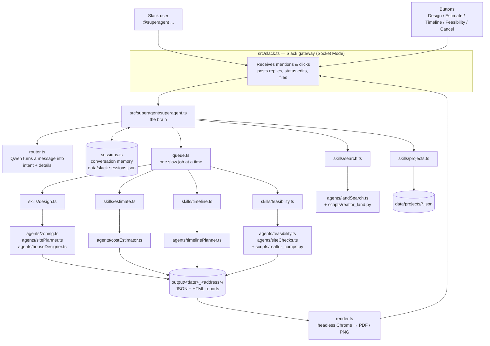

# SuperAgent — construction assistant for Slack

SuperAgent is a Slack bot that helps a small builder or developer go from "where can I build?" to "is it worth it?" — and keeps an eye on the projects already under construction. You tag it in a channel in plain English; it finds land, designs houses that fit the local zoning, estimates the cost, plans the construction schedule, writes a feasibility report, and reports on ongoing projects.

Everything runs on your own machine: the AI model runs locally through [Ollama](https://ollama.com) (Qwen 3.5 9B by default), and the bot connects to Slack without needing a public server.

```
@superagent land around 300k in Austin, TX
@superagent design a house on Corral Lane
@superagent estimate the cost for 8446 Corral Ln
@superagent timeline starting Jan 4
@superagent feasibility report for 8446 Corral Ln
@superagent which projects are delayed?
@superagent why is River Bend late?
```

> All results are planning-level concepts produced with an AI model and public data. They are not construction drawings, bids, appraisals or legal advice.

---

## What it can do

| Feature                   | What you get                                                                                                                                                                                                                                     | Typical time                  |
| ------------------------- | ------------------------------------------------------------------------------------------------------------------------------------------------------------------------------------------------------------------------------------------------ | ----------------------------- |
| **Land search**           | For-sale land listings from Realtor.com in a city and budget ("300k", "200k–350k", "under 400k"), each with a **Design on this lot** button                                                                                                      | ~5–10 s                       |
| **House design**          | Looks up the lot's zoning (Austin, TX zoning map; defaults elsewhere), decides how many homes fit (one house, several homes, or subdividing), and draws a site plan and floor plans. Posts a preview image and a PDF                             | ~5 min                        |
| **Cost estimate**         | Materials and labor trade by trade (foundation, framing, roofing, …), with a contingency. Posts a summary and a detailed PDF                                                                                                                     | ~10 min                       |
| **Construction timeline** | Every construction task with dates (weekends and US holidays skipped), the critical path, inspections, milestones and risks. Posts a summary and a Gantt-chart PDF                                                                               | ~3 min                        |
| **Feasibility report**    | Flood zone, soil, Edwards Aquifer and utility checks; values and rents from nearby homes; profit if you **build and sell** vs. yield if you **build and rent**; a go / marginal / no-go verdict, risks and next steps. Posts a summary and a PDF | ~20 s (+ estimate if missing) |
| **Ongoing projects**      | Lists construction projects with status (on track / at risk / delayed / on hold), current stage and % done; explains what's happening on one project and what's causing a delay                                                                  | ~1–5 s                        |

Slow jobs run one at a time in a queue, show live progress with a **Cancel** button, and survive a bot restart.

---

## Architecture



### How a request flows

1. **Slack gateway** (`src/slack.ts`) receives a mention or a button click over Slack Socket Mode (the bot connects _out_ to Slack, so no public URL is needed). It decides which conversation's memory to use and hands the request to the brain.
2. **The brain** (`src/superagent/superagent.ts`) loads the conversation memory and asks the **router** what the user wants.
3. **The router** (`src/superagent/router.ts`) makes one structured call to Qwen that fills in a fixed form: the intent (`search`, `design`, `estimate`, `timeline`, `feasibility`, `projects`, `status`, `cancel`, `help`) plus details such as city, budget, property name, start date or project name.
4. **Quick requests** (search, projects, status, help, cancel) are answered right away.
5. **Slow jobs** (design, estimate, timeline, feasibility) go into the **job queue** (`queue.ts`). The bot posts a status message with a **Cancel** button and edits it as the job progresses. When the job finishes it posts a summary and uploads the PDF.
6. **Skills** (`src/superagent/skills/`) are thin wrappers that run the **agents** (`src/agents/`), which do the real work and write their results into a plan folder in `output/`.

### Design principles

- **The AI decides and writes; code does the math and checks.** Qwen chooses the site strategy, draws the plan, estimates quantities, lists construction tasks and writes summaries. Code computes footprints, dates, the critical path, costs, profits, verdicts and project status — and validates the model's answers, sending specific errors back for a retry.
- **Structured output.** Every non-drawing model call uses Ollama's JSON-schema output (schemas defined with `zod`), so replies always have the expected shape.
- **Facts in, prose out.** Summaries (project status, delay explanations, feasibility) are written by Qwen from a fact sheet code prepares, with instructions to use only those facts.
- **Names, not numbers.** People refer to properties and projects by name ("Corral Lane", "the River Bend job"). Matching is done in code (`match.ts`), including street abbreviations ("Lane" ↔ "Ln") and house numbers, and the bot asks when a name is ambiguous.
- **Fail soft.** If a public data source is down, that check says "not checked" and the report carries on with lower confidence.

---

## Components

### Slack layer — `src/slack.ts` and `src/superagent/`

| File                       | Responsibility                                                                                                                                                   |
| -------------------------- | ---------------------------------------------------------------------------------------------------------------------------------------------------------------- |
| `slack.ts`                 | Connects to Slack (Bolt, Socket Mode); handles mentions and buttons; posts replies, throttled status edits and file uploads; resumes interrupted jobs at startup |
| `superagent/superagent.ts` | The brain: routes each request to a skill, queues slow jobs, resolves which listing or plan a request refers to, handles cancel and restart recovery             |
| `superagent/router.ts`     | Turns a Slack message into a structured request using Qwen                                                                                                       |
| `superagent/sessions.ts`   | Conversation memory (last search, listings, chosen lot, latest plan, queued jobs), saved to `data/slack-sessions.json`                                           |
| `superagent/queue.ts`      | One-at-a-time job queue with duplicate detection, per-person limits and cancellation                                                                             |
| `superagent/match.ts`      | Fuzzy name matching for listings, plans and projects                                                                                                             |
| `superagent/plans.ts`      | Finds the saved plan folder for a property                                                                                                                       |
| `superagent/health.ts`     | Checks Ollama is running and the models are downloaded before starting a job                                                                                     |
| `superagent/render.ts`     | Prints HTML reports to PDF and the plan drawing to PNG with headless Chrome                                                                                      |
| `superagent/slackUi.ts`    | All Slack message text, layouts (Block Kit) and buttons                                                                                                          |
| `superagent/skills/*`      | One file per skill: search, design, estimate, timeline, feasibility, projects                                                                                    |

### Agents — `src/agents/`

| Agent                | What it does                                                                                                                                                                                            |
| -------------------- | ------------------------------------------------------------------------------------------------------------------------------------------------------------------------------------------------------- |
| `landSearch.ts`      | Runs `scripts/realtor_land.py` (the `homeharvest` library) to fetch for-sale land listings                                                                                                              |
| `zoning.ts`          | Finds the lot's zoning district from the City of Austin zoning map and the rules from `data/zoning/austin-tx.json` (including Austin's HOME rules for up to 3 homes per lot and small-lot subdivisions) |
| `sitePlanner.ts`     | Qwen decides the best use of the land — one house, several homes, or subdividing — and the size and layout of each house type; code checks it against setbacks, coverage and height                     |
| `houseDesigner.ts`   | Qwen draws the site plan and floor plans as an SVG; writes `plan.svg` and `plan.html`                                                                                                                   |
| `costEstimator.ts`   | Reads the plan into a spec, then Qwen estimates materials and labor for each trade; writes `estimate.json`, `materials.md`, `materials.html`                                                            |
| `timelinePlanner.ts` | Qwen lists the construction tasks and durations; code schedules them on a working-day calendar and finds the critical path; writes `timeline.json`, `timeline.md`, `timeline.html`                      |
| `siteChecks.ts`      | Flood zone (FEMA flood map via Esri), soil (USDA Soil Data Access), Edwards Aquifer zone (TCEQ), utility availability                                                                                   |
| `feasibility.ts`     | Comparable sales and rentals (`scripts/realtor_comps.py`), full cost stack, build-and-sell and build-and-rent numbers, what-if cases, verdicts, risks; writes `feasibility.json` and `feasibility.html` |

### Shared code — `src/`

| File                                        | Responsibility                                                                                                        |
| ------------------------------------------- | --------------------------------------------------------------------------------------------------------------------- |
| `llm.ts`                                    | Ollama calls: `chatJson` (structured JSON) and `chatText` (streaming, used for drawing)                               |
| `report.ts`                                 | HTML page template and styles shared by all reports (with tabs between Plan, Cost estimate, Timeline and Feasibility) |
| `refreshReports.ts`                         | Rebuilds every HTML report in a plan folder from its saved JSON                                                       |
| `budget.ts`, `listingFormat.ts`, `paths.ts` | Budget parsing, listing formatting, project paths                                                                     |

---

## Data and outputs

| Path                             | Contents                                                                                                                                                                                |
| -------------------------------- | --------------------------------------------------------------------------------------------------------------------------------------------------------------------------------------- |
| `data/zoning/austin-tx.json`     | Austin residential zoning rules per district (setbacks, height, coverage, units, minimum lot sizes)                                                                                     |
| `data/projects/*.json`           | Ongoing construction projects (currently dummy data): dates, 12 standard stages, issues with days of delay, inspections, site log                                                       |
| `data/feasibility-defaults.json` | Assumptions for the feasibility report: loan terms, fees, vacancy, verdict thresholds, typical build cost — edit to match how you work                                                  |
| `data/slack-sessions.json`       | The bot's conversation memory (git-ignored)                                                                                                                                             |
| `output/<date>_<address>/`       | One folder per design: `plan.svg/.html/.pdf/.png`, `strategy.json`, `estimate.json` + `materials.*`, `timeline.json` + `timeline.*`, `feasibility.json` + `feasibility.*` (git-ignored) |

### External data sources

| Source                                                | Used for                                            |
| ----------------------------------------------------- | --------------------------------------------------- |
| Realtor.com via `homeharvest` (Python)                | Land listings, recently sold homes, rental listings |
| City of Austin zoning map (ArcGIS)                    | Zoning district of a lot                            |
| FEMA National Flood Hazard Layer (Esri's public copy) | Flood zone                                          |
| USDA Soil Data Access                                 | Soil type and rating for houses on concrete slabs   |
| TCEQ Edwards Aquifer map                              | Recharge / transition / contributing zones          |

Texas does not disclose sale prices, so "sold" comparables use the homes' last asking prices; the feasibility report says so.

---

## Setup

### Requirements

- **Node.js 22+**
- **Python 3** (for the Realtor.com scraper)
- **[Ollama](https://ollama.com)** with the model pulled: `ollama pull qwen3.5:9b`
- **Google Chrome** (used headless to make PDFs and images; set `CHROME_PATH` if it isn't in `/Applications`)
- A **Slack workspace** where you can create an app

### Install

```bash
npm install
npm run setup          # creates .venv and installs homeharvest
cp .env.example .env   # then fill in the Slack tokens
```

### Create the Slack app

1. At [api.slack.com/apps](https://api.slack.com/apps) create an app **from scratch**.
2. **Socket Mode**: turn on and create an app-level token with `connections:write` → `SLACK_APP_TOKEN` (`xapp-…`).
3. **OAuth & Permissions → Bot Token Scopes**: `app_mentions:read`, `chat:write`, `reactions:write`, `files:write`.
4. **Event Subscriptions**: turn on and subscribe to the bot event `app_mention`.
5. **Interactivity & Shortcuts**: turn on (needed for the buttons; no URL needed with Socket Mode).
6. **App Home**: set the display name (e.g. _SuperAgent_) and username (e.g. `superagent`).
7. **Install to Workspace** → bot token → `SLACK_BOT_TOKEN` (`xoxb-…`).
8. In Slack, `/invite @superagent` into a channel.

### Configuration (`.env`)

| Variable                             | Default       | Meaning                                                                                                                                                              |
| ------------------------------------ | ------------- | -------------------------------------------------------------------------------------------------------------------------------------------------------------------- |
| `SLACK_BOT_TOKEN`, `SLACK_APP_TOKEN` | —             | Slack credentials (required)                                                                                                                                         |
| `SLACK_REPLY_MODE`                   | `channel`     | `channel`: reply in the channel, one shared memory per channel · `user`: reply in the channel, a memory per person · `thread`: reply in threads, a memory per thread |
| `DESIGN_MODEL`                       | `qwen3.5:9b`  | Model that plans the site and draws the house                                                                                                                        |
| `ESTIMATE_MODEL`                     | `qwen3.5:9b`  | Model for cost estimates and timelines                                                                                                                               |
| `DESIGN_THINK`                       | `true`        | Let the model reason before drawing (better plans, ~2–3× slower)                                                                                                     |
| `CHROME_PATH`                        | macOS default | Path to Chrome, if elsewhere                                                                                                                                         |

### Run

```bash
npm run dev
```

The bot prints `SuperAgent is running (reply mode: channel)`, checks that Ollama and the models are available, and resumes any jobs interrupted by the last restart. Tag it in a channel it has been invited to.

**Tip:** Ollama answers one request at a time by default, so quick questions wait while a long design is being drawn. Starting Ollama with `OLLAMA_NUM_PARALLEL=2` lets quick replies run alongside a job (uses more memory). On macOS with the Ollama app: `launchctl setenv OLLAMA_NUM_PARALLEL 2`, then restart Ollama.

### Development

```bash
npm run typecheck   # TypeScript
npm run lint        # ESLint
npm run format      # Prettier
```

`src/test-freecad.ts` / `src/floorPlanner.ts` (a FreeCAD floor-plan experiment) and `src/test-architecture.ts` / `src/tools/architecture.ts` (a FLUX image-generation test) are standalone experiments, not part of the bot.

---

## Limitations

- **Model quality.** With a 9B model, drawings can have layout mistakes and cost estimates can be off — the feasibility report flags build costs outside a typical $/sq ft range. Pointing `DESIGN_MODEL` / `ESTIMATE_MODEL` at a stronger model improves results without code changes.
- **Austin-first.** Zoning lookups and the Edwards Aquifer check cover Austin, TX; elsewhere the bot uses typical residential defaults and says so.
- **Planning-level data.** Values use asking prices of sold homes, soil comes from a regional survey (not borings), utility capacity isn't public, and FEMA maps can lag local floodplain maps.
- **Runs locally.** The bot works while your machine, Ollama and `npm run dev` are running; jobs run one at a time.
- **Dummy project data.** `data/projects/` currently holds sample projects; the format is ready to be fed with real data.
