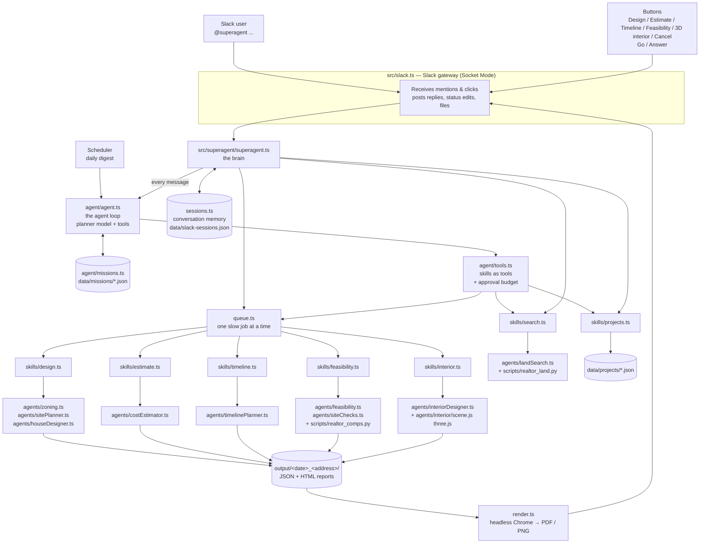

# SuperAgent — construction assistant for Slack

SuperAgent is a Slack bot that helps a small builder or developer go from "where can I build?" to "is it worth it?" — and keeps an eye on the projects already under construction. You tag it in a channel in plain English; it finds land, designs houses that fit the local zoning, estimates the cost, plans the construction schedule, writes a feasibility report, and reports on ongoing projects.

Give it a **goal** instead of a single task and it works as an **agent**: it decides on its own which of those skills to use and in what order, checks results, changes course, asks you when it needs to, and asks your approval before any long-running work. It also acts on its own: a daily project digest.

The bot runs on your own machine and connects to Slack without needing a public server. Its AI is Claude, used through the Claude Code CLI and your Claude subscription (Sonnet for the agent, design and estimates); it can also run fully locally on [Ollama](https://ollama.com) (Qwen 3.5 9B) with `LLM_BACKEND=ollama`.

```
@superagent land around 300k in Austin, TX
@superagent design a house on Corral Lane
@superagent estimate the cost for 8446 Corral Ln
@superagent timeline starting Jan 4
@superagent feasibility report for 8446 Corral Ln
@superagent which projects are delayed?
@superagent why is River Bend late?

# goals: the agent plans the steps itself
@superagent find the best lot under 250k in Austin, TX to build on and sell
@superagent find land under 300k in Austin and tell me which lots have no flood or soil problems
@superagent compare the plans for Brass Buttons and Corral Lane — which is the better investment?
@superagent which delayed projects have open permit issues, and what's the next step on each?
```

> All results are planning-level concepts produced with an AI model and public data. They are not construction drawings, bids, appraisals or legal advice.

---

## What it can do

| Feature                   | What you get                                                                                                                                                                                                                                     | Typical time                  |
| ------------------------- | ------------------------------------------------------------------------------------------------------------------------------------------------------------------------------------------------------------------------------------------------ | ----------------------------- |
| **Land search**           | For-sale land listings from Realtor.com in a city and budget ("300k", "200k–350k", "under 400k"), each with a **Design on this lot** button                                                                                                      | ~5–10 s                       |
| **House design**          | Looks up the lot's zoning (Austin, TX zoning map; defaults elsewhere), decides how many homes fit (one house, several homes, or subdividing), and draws a site plan and floor plans. Posts a preview image and a PDF                             | ~5 min                        |
| **Cost estimate**         | Materials and labor trade by trade (foundation, framing, roofing, …), with a contingency. Posts a summary and a detailed PDF                                                                                                                     | ~10 min                       |
| **Construction timeline** | Every construction task with dates (weekends and US holidays skipped), the critical path, inspections, milestones and risks. Posts a summary and a Gantt-chart PDF                                                                               | ~3 min                        |
| **Feasibility report**    | Flood zone, soil, Edwards Aquifer and utility checks; values and rents from nearby homes; profit if you **build and sell** vs. yield if you **build and rent**; a go / marginal / no-go verdict, risks and next steps. Posts a summary and a PDF | ~20 s (+ estimate if missing) |
| **3D interior**           | A furnished 3D top view of every floor of a plan (walls cut low, real furniture, floors and finishes in a style picked for the house and its price). Posts a PDF with one picture per page and no text                                           | ~2–4 min                      |
| **Ongoing projects**      | Lists construction projects with status (on track / at risk / delayed / on hold), current stage and % done; explains what's happening on one project and what's causing a delay                                                                  | ~1–5 s                        |
| **Goals (the agent)**     | Multi-step requests: searches, site checks, designs, feasibility reports and comparisons chained by the agent itself, with a live checklist, a plan you approve before slow work, and a final recommendation built on the results                | ~20 s (quick tools) to ~1 h   |
| **Daily digest**          | Every morning (optional) the agent posts which projects need attention, what's holding them up, the next steps and upcoming inspections                                                                                                          | ~30 s                         |

Slow jobs run one at a time in a queue, show live progress with a **Cancel** button, and survive a bot restart. So do the agent's missions.

---

## Architecture



### How a request flows

1. **Slack gateway** (`src/slack.ts`) receives a mention or a button click over Slack Socket Mode (the bot connects _out_ to Slack, so no public URL is needed). It decides which conversation's memory to use and hands the request to the brain.
2. **The brain** (`src/superagent/superagent.ts`) handles a few things in code, because they must be instant and predictable: a reply to a plan or question the agent is waiting on, `cancel`/`stop`, and `help`/`hi`. **Every other message goes to the agent** (`src/superagent/agent/`), described below. It answers quick questions in a few seconds and works through multi-step goals on its own.
3. **Slow jobs** (design, estimate, timeline, feasibility, 3D interior) go into the **job queue** (`queue.ts`). The bot posts a status message with a **Cancel** button and edits it as the job progresses. When the job finishes it posts a summary and uploads the PDF. Buttons start these jobs directly, without the agent.
4. **Skills** (`src/superagent/skills/`) are thin wrappers that run the **agents** (`src/agents/`), which do the real work and write their results into a plan folder in `output/`.

### The agent

Every message goes to an agent that works out the steps itself. The agent runs on the **[Claude Agent SDK](https://docs.claude.com/en/api/agent-sdk/overview)** (the engine behind Claude Code), with SuperAgent's skills served to it as tools from an in-process MCP server:

1. Claude (`PLANNER_MODEL`) gets the message, the recent exchanges in this conversation (requests, steps taken and answers, up to 5 from the last 3 hours) and the list of **tools**.
2. It calls tools (e.g. `search_land("Austin, TX", "under 250k")`, often several at once) or gives its final answer.
3. Code checks each call against the tool's schema, runs it, and returns a short result. Bad calls get a specific error back so the model can correct itself.
4. Repeat until it answers. Claude Code's own tools (files, shell, web) are turned off and no local settings are loaded, so it can only use SuperAgent's tools.

| Tool                                                                                      | Kind                      | What it does                                                                         |
| ----------------------------------------------------------------------------------------- | ------------------------- | ------------------------------------------------------------------------------------ |
| `search_land`                                                                             | quick                     | Land listings in a city and budget (posts them with links)                           |
| `check_site`                                                                              | quick                     | Flood, soil, aquifer and utility flags for up to 10 lots, without designing anything |
| `list_saved_plans`, `compare_plans`                                                       | quick                     | Which properties have plans; a ranked side-by-side table built by code               |
| `list_projects`, `project_details`                                                        | quick                     | Project status, delay causes, open issues and next steps                             |
| `conversation_status`                                                                     | quick                     | What happened in this conversation and what is running now                           |
| `design_house`, `estimate_cost`, `plan_timeline`, `feasibility_report`, `design_interior` | slow (minutes, via queue) | The existing skills; results and PDFs are posted as usual                            |
| `propose_plan`, `ask_user`                                                                | control                   | Pause the mission for approval or an answer                                          |

**What code guarantees, whatever the model decides:**

- **Approval before slow work.** Slow tools only run after you click **Go** on a plan that lists them, and only as many of each kind as you approved (at most 3 designs and 9 slow steps per plan). Reply to the plan instead of clicking Go to change it. The one exception is a request for exactly one slow job ("design a house on 8446 Corral Ln"): one slow job may run without a plan, once per mission.
- **Limits.** At most 25 model turns per mission; then it must answer with what it has. The same call twice in a row is refused. At most 3 unfinished missions per conversation, so a quick question doesn't wait for a long goal.
- **Numbers from tools.** Comparison tables are built by code from the saved reports; the model is told to use only tool results.
- **Its own lots.** The agent's designs don't change the conversation's "selected lot" or "latest plan"; it names properties itself.

**Missions** (`agent/missions.ts`) record each goal: the Agent SDK session id, the checklist shown in Slack, what was approved, and what it's waiting for. They are saved to `data/missions/<id>.json` after every step. `propose_plan` and `ask_user` end the model's turn; your answer resumes the saved session, minutes or hours later, even after a restart (an interrupted job can be run again). The full transcript of every decision is in the session file under `~/.claude/projects/`.

**Proactive:** with `DIGEST_CHANNEL` set, the scheduler (`agent/schedule.ts`) starts a mission every morning to brief the team on projects that need attention. Scheduled missions only get quick tools, since nobody is there to approve a plan.

### Design principles

- **The AI decides and writes; code does the math and checks.** Qwen chooses the site strategy, draws the plan, estimates quantities, lists construction tasks and writes summaries. Code computes footprints, dates, the critical path, costs, profits, verdicts and project status — and validates the model's answers, sending specific errors back for a retry.
- **Structured output.** Every non-drawing model call uses JSON-schema output (schemas defined with `zod`; `--json-schema` on Claude Code, `format` on Ollama), so replies always have the expected shape.
- **Facts in, prose out.** Written answers (the agent's replies, feasibility summaries) come from facts code prepares, with instructions to use only those facts.
- **Names, not numbers.** People refer to properties and projects by name ("Corral Lane", "the River Bend job"). Matching is done in code (`match.ts`), including street abbreviations ("Lane" ↔ "Ln") and house numbers, and the bot asks when a name is ambiguous.
- **Fail soft.** If a public data source is down, that check says "not checked" and the report carries on with lower confidence.

---

## Components

### Slack layer — `src/slack.ts` and `src/superagent/`

| File                       | Responsibility                                                                                                                                                  |
| -------------------------- | --------------------------------------------------------------------------------------------------------------------------------------------------------------- |
| `main.ts`                  | Entry point: starts the web API and (when its tokens are set) Slack in one process; checks the models, resumes interrupted jobs and missions, starts the digest |
| `slack.ts`                 | Connects to Slack (Bolt, Socket Mode); handles mentions and buttons; posts replies, throttled status edits and file uploads                                     |
| `superagent/superagent.ts` | The brain: sends messages to the agent, queues slow jobs, resolves which listing or plan a request refers to, handles cancel and restart recovery               |
| `superagent/sessions.ts`   | Conversation memory (last search, listings, chosen lot, latest plan, queued jobs), saved to `data/slack-sessions.json`                                          |
| `superagent/queue.ts`      | One-at-a-time job queue with duplicate detection, per-person limits and cancellation                                                                            |
| `superagent/match.ts`      | Fuzzy name matching for listings, plans and projects                                                                                                            |
| `superagent/plans.ts`      | Finds the saved plan folder for a property                                                                                                                      |
| `superagent/health.ts`     | Checks the model backend is ready (Claude Code logged in, or Ollama running with the models) before starting a job                                              |
| `superagent/render.ts`     | Prints HTML reports to PDF and the plan drawing to PNG with headless Chrome                                                                                     |
| `superagent/slackUi.ts`    | All Slack message text, layouts (Block Kit) and buttons                                                                                                         |
| `superagent/skills/*`      | One file per skill: search, design, estimate, timeline, feasibility, projects                                                                                   |

### The agent — `src/superagent/agent/`

| File           | Responsibility                                                                                                                                |
| -------------- | --------------------------------------------------------------------------------------------------------------------------------------------- |
| `agent.ts`     | Runs missions on the Claude Agent SDK: serves the tools, enforces limits, pauses and resumes sessions; start, approve, answer, cancel, resume |
| `tools.ts`     | The skills as tools (schemas, short results for the model), the approval budget for slow jobs, `propose_plan`, `ask_user`                     |
| `missions.ts`  | Mission state and log, saved to `data/missions/<id>.json`                                                                                     |
| `missionUi.ts` | Slack layouts: live checklist, plan with Go / Cancel, questions with answer buttons, comparison table, final answer                           |
| `schedule.ts`  | Proactive work: the daily project digest                                                                                                      |

### Web API — `src/web/`

The API behind the web UI (dashboard, project screen, chat), on `HTTP_PORT` (default 3001). No logins: every request is the same user.

| Method and path                    | What it does                                                                                                      |
| ---------------------------------- | ----------------------------------------------------------------------------------------------------------------- |
| `GET /projects`                    | Project cards, most urgent first. `?filter=all\|delayed\|behind\|attention\|on-hold`, `?completed=true`           |
| `GET /projects/summary`            | Counts by status, open issues, contract value and spend, for the dashboard tiles                                  |
| `GET /projects/:id`                | Everything about one project (an id, or a name like `river bend`; 409 lists the options if it is ambiguous)       |
| `GET /conversations`               | Chats, newest first (title, project, whether the agent is still working)                                          |
| `POST /conversations`              | New chat: `{ "projectId"?: "..." }` makes its first message about that project                                    |
| `GET /conversations/:id`           | A chat with all its messages                                                                                      |
| `DELETE /conversations/:id`        | Delete a chat                                                                                                     |
| `POST /conversations/:id/messages` | `{ "text": "..." }`: returns at once; the agent's replies arrive on the stream                                    |
| `POST /conversations/:id/actions`  | `{ "actionId", "value" }` from a message's `actions` (Go, Cancel, answers, Estimate cost, …)                      |
| `GET /conversations/:id/stream`    | Server-Sent Events: a `message` event with every new or changed message (status lines change in place, same `id`) |
| `GET /files/:token`                | Plan images and PDFs linked from messages                                                                         |

Messages are Markdown. A status message carries `mission` (the agent's goal, state, checklist, and the plan or question it waits on) while the agent works on a goal.

| File               | Responsibility                                                                                              |
| ------------------ | ----------------------------------------------------------------------------------------------------------- |
| `server.ts`        | Express app: routes, request checks, the live stream, files                                                 |
| `output.ts`        | The agent's Output for web chats: Slack layouts become Markdown and actions; one status message per mission |
| `conversations.ts` | Chat history, saved to `data/conversations/<id>.json`                                                       |
| `projects.ts`      | Project cards, details and counts, from the same facts the agent reports                                    |

### Agents — `src/agents/`

| Agent                 | What it does                                                                                                                                                                                                                                                                                                                                 |
| --------------------- | -------------------------------------------------------------------------------------------------------------------------------------------------------------------------------------------------------------------------------------------------------------------------------------------------------------------------------------------- |
| `landSearch.ts`       | Runs `scripts/realtor_land.py` (the `homeharvest` library) to fetch for-sale land listings                                                                                                                                                                                                                                                   |
| `zoning.ts`           | Site rule types and defaults; finds the lot's zoning district from the City of Austin zoning map when the lot is in Austin                                                                                                                                                                                                                   |
| `siteRules.ts`        | Researches what can be built on a lot anywhere in the US with web search: district, setbacks, coverage, height, FAR, parking, which housing types are allowed, overlays, state laws, with sources                                                                                                                                            |
| `sitePlanner.ts`      | Qwen decides the best use of the land — one house, several homes, or subdividing — and the size and layout of each house type; code checks it against setbacks, coverage and height                                                                                                                                                          |
| `houseDesigner.ts`    | Qwen draws the site plan and floor plans as an SVG; writes `plan.svg` and `plan.html`                                                                                                                                                                                                                                                        |
| `costEstimator.ts`    | Reads the plan into a spec, then Qwen estimates materials and labor for each trade; writes `estimate.json`, `materials.md`, `materials.html`                                                                                                                                                                                                 |
| `timelinePlanner.ts`  | Qwen lists the construction tasks and durations; code schedules them on a working-day calendar and finds the critical path; writes `timeline.json`, `timeline.md`, `timeline.html`                                                                                                                                                           |
| `siteChecks.ts`       | Flood zone (FEMA flood map via Esri), soil (USDA Soil Data Access), Edwards Aquifer zone (TCEQ), utility availability                                                                                                                                                                                                                        |
| `interiorDesigner.ts` | Claude reads each floor's rooms, doors and windows out of `plan.svg`, picks a style, and places furniture from a catalog; code builds the walls and checks every piece fits; `interior/scene.js` renders each floor in three.js in headless Chrome; writes `interior.json`, `interior-<type>-<floor>.png` and `interior.pdf` (pictures only) |
| `feasibility.ts`      | Comparable sales and rentals (`scripts/realtor_comps.py`), full cost stack, build-and-sell and build-and-rent numbers, what-if cases, verdicts, risks; writes `feasibility.json` and `feasibility.html`                                                                                                                                      |

### Shared code — `src/`

| File                                        | Responsibility                                                                                                                                             |
| ------------------------------------------- | ---------------------------------------------------------------------------------------------------------------------------------------------------------- |
| `llm.ts`                                    | The skills' model calls: `chatJson` (structured JSON) and `chatText` (streaming, used for drawing), on Claude Code or Ollama                               |
| `claudeCode.ts`                             | Runs one locked-down `claude -p` call (no files, shell or local settings; only site rules research may search the web) and checks Claude Code is logged in |
| `report.ts`                                 | HTML page template and styles shared by all reports (with tabs between Plan, Cost estimate, Timeline and Feasibility)                                      |
| `refreshReports.ts`                         | Rebuilds every HTML report in a plan folder from its saved JSON                                                                                            |
| `budget.ts`, `listingFormat.ts`, `paths.ts` | Budget parsing, listing formatting, project paths                                                                                                          |

---

## Data and outputs

| Path                             | Contents                                                                                                                                                                                                                                     |
| -------------------------------- | -------------------------------------------------------------------------------------------------------------------------------------------------------------------------------------------------------------------------------------------- |
| `data/site-rules/<place>.json`   | Cached site rules research per address, reused for 30 days (1 day if low confidence) (git-ignored)                                                                                                                                           |
| `data/projects/*.json`           | Ongoing construction projects (currently dummy data): dates, 12 standard stages, issues with days of delay, inspections, site log                                                                                                            |
| `data/feasibility-defaults.json` | Assumptions for the feasibility report: loan terms, fees, vacancy, verdict thresholds, typical build cost — edit to match how you work                                                                                                       |
| `data/slack-sessions.json`       | The bot's conversation memory (git-ignored)                                                                                                                                                                                                  |
| `data/missions/<id>.json`        | The agent's missions: goal, Agent SDK session id, checklist, approvals (git-ignored)                                                                                                                                                         |
| `data/conversations/<id>.json`   | Web chats with all their messages (git-ignored)                                                                                                                                                                                              |
| `data/digest.json`               | Date of the last daily digest (git-ignored)                                                                                                                                                                                                  |
| `output/<date>_<address>/`       | One folder per design: `plan.svg/.html/.pdf/.png`, `strategy.json`, `estimate.json` + `materials.*`, `timeline.json` + `timeline.*`, `feasibility.json` + `feasibility.*`, `interior.json` + `interior-*.png` + `interior.pdf` (git-ignored) |

### External data sources

| Source                                                | Used for                                            |
| ----------------------------------------------------- | --------------------------------------------------- |
| Realtor.com via `homeharvest` (Python)                | Land listings, recently sold homes, rental listings |
| City of Austin zoning map (ArcGIS)                    | Zoning district of a lot                            |
| FEMA National Flood Hazard Layer (Esri's public copy) | Flood zone                                          |
| USDA Soil Data Access                                 | Soil type and rating for houses on concrete slabs   |
| TCEQ Edwards Aquifer map                              | Recharge / transition / contributing zones          |

Texas does not disclose sale prices, so "sold" comparables use the homes' last asking prices; the feasibility report says so.

---

## Setup

### Requirements

- **Node.js 22+**
- **Python 3** (for the Realtor.com scraper)
- **[Claude Code](https://docs.claude.com/en/docs/claude-code)** logged in with a Claude subscription: `npm install -g @anthropic-ai/claude-code`, then run `claude` once and log in. (Or, with `LLM_BACKEND=ollama`, **[Ollama](https://ollama.com)** with `ollama pull qwen3.5:9b`.)
- **Google Chrome** (used headless to make PDFs and images; set `CHROME_PATH` if it isn't in `/Applications`)
- A **Slack workspace** where you can create an app

### Install

```bash
npm install
npm run setup          # creates .venv and installs homeharvest
cp .env.example .env   # then fill in the Slack tokens
```

### Create the Slack app

1. At [api.slack.com/apps](https://api.slack.com/apps) create an app **from scratch**.
2. **Socket Mode**: turn on and create an app-level token with `connections:write` → `SLACK_APP_TOKEN` (`xapp-…`).
3. **OAuth & Permissions → Bot Token Scopes**: `app_mentions:read`, `chat:write`, `reactions:write`, `files:write`.
4. **Event Subscriptions**: turn on and subscribe to the bot event `app_mention`.
5. **Interactivity & Shortcuts**: turn on (needed for the buttons; no URL needed with Socket Mode).
6. **App Home**: set the display name (e.g. _SuperAgent_) and username (e.g. `superagent`).
7. **Install to Workspace** → bot token → `SLACK_BOT_TOKEN` (`xoxb-…`).
8. In Slack, `/invite @superagent` into a channel.

### Configuration (`.env`)

| Variable                             | Default       | Meaning                                                                                                                                                              |
| ------------------------------------ | ------------- | -------------------------------------------------------------------------------------------------------------------------------------------------------------------- |
| `HTTP_PORT`                          | `3001`        | Port of the web API; `off` turns it off                                                                                                                              |
| `CORS_ORIGIN`                        | `*`           | Which web origin may call the API from a browser                                                                                                                     |
| `SLACK_BOT_TOKEN`, `SLACK_APP_TOKEN` | —             | Slack credentials; without them only the web API runs                                                                                                                |
| `SLACK_REPLY_MODE`                   | `channel`     | `channel`: reply in the channel, one shared memory per channel · `user`: reply in the channel, a memory per person · `thread`: reply in threads, a memory per thread |
| `LLM_BACKEND`                        | `claude-code` | `claude-code`: Claude through the Claude Code CLI and the logged-in subscription · `ollama`: a local model through Ollama                                            |
| `PLANNER_MODEL`                      | `sonnet`      | Claude model that drives the agent (chooses tools for goals). Always Claude, via the Agent SDK, even with `LLM_BACKEND=ollama`                                       |
| `DESIGN_MODEL`                       | `sonnet`      | Model that plans the site and draws the house. Ollama default: `qwen3.5:9b`                                                                                          |
| `ESTIMATE_MODEL`                     | `sonnet`      | Model for cost estimates and timelines. Ollama default: `qwen3.5:9b`                                                                                                 |
| `DESIGN_THINK`                       | `true`        | Let the model reason before drawing (better plans, slower)                                                                                                           |
| `PLANNER_THINK`                      | `true`        | Let the planner reason before each decision (more accurate answers, a few seconds slower)                                                                            |
| `DIGEST_CHANNEL`                     | —             | Slack channel id for the daily project digest; empty = no digest                                                                                                     |
| `DIGEST_TIME`                        | `08:30`       | When to post the digest (HH:MM, this computer's time zone)                                                                                                           |
| `CHROME_PATH`                        | macOS default | Path to Chrome, if elsewhere                                                                                                                                         |

### Run

```bash
npm run dev
```

It starts the web API (`Web API on http://localhost:3001`) and, when the Slack tokens are set, connects to Slack. It prints which models it uses, checks that Claude Code is logged in (or Ollama has the models), and resumes any jobs interrupted by the last restart. Tag it in a channel it has been invited to.

**Claude Code backend.** Each model call runs `claude -p` with all of Claude Code's own tools, settings and MCP servers turned off, in an empty folder, so a Slack message can't make it touch the computer. Usage counts against the logged-in subscription's limits; when they're reached the bot says so until they reset. A subscription is meant for one person's use: for a bot a whole team relies on, an API key is the cleaner route.

**Tip (Ollama only):** Ollama answers one request at a time by default, so quick questions wait while a long design is being drawn. Starting Ollama with `OLLAMA_NUM_PARALLEL=2` lets quick replies run alongside a job (uses more memory). On macOS with the Ollama app: `launchctl setenv OLLAMA_NUM_PARALLEL 2`, then restart Ollama.

### Development

```bash
npm run typecheck   # TypeScript
npm run lint        # ESLint
npm run format      # Prettier

# Try the agent in the terminal, without Slack (uses its own memory in /tmp):
node --import tsx src/test-agent.ts "compare the plans for Brass Buttons and Corral Lane"
node --import tsx src/test-agent.ts --suite                    # a set of goals using quick tools
node --import tsx src/test-agent.ts "<goal>" --approve         # also click Go (slow jobs really run)
```

`src/test-freecad.ts` / `src/floorPlanner.ts` (a FreeCAD floor-plan experiment) and `src/test-architecture.ts` / `src/tools/architecture.ts` (a FLUX image-generation test) are standalone experiments, not part of the bot.

---

## Limitations

- **Model quality.** Drawings can still have layout mistakes and cost estimates can be off (much more so on the local 9B model) — the feasibility report flags build costs outside a typical $/sq ft range.
- **Subscription limits.** On the Claude Code backend, heavy use (several designs in a row) can reach the subscription's usage limit; the bot pauses until it resets.
- **Austin-first.** Zoning lookups and the Edwards Aquifer check cover Austin, TX; elsewhere the bot uses typical residential defaults and says so.
- **Planning-level data.** Values use asking prices of sold homes, soil comes from a regional survey (not borings), utility capacity isn't public, and FEMA maps can lag local floodplain maps.
- **Runs on your machine.** The bot works while your machine and `npm run dev` are running (plus Ollama on that backend); jobs run one at a time.
- **Dummy project data.** `data/projects/` currently holds sample projects; the format is ready to be fed with real data.
